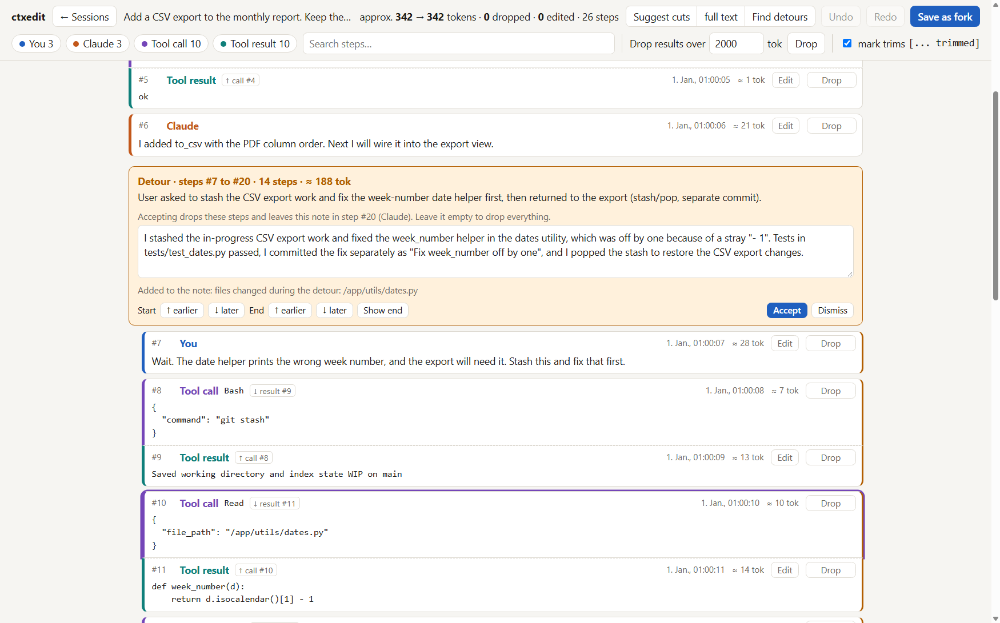
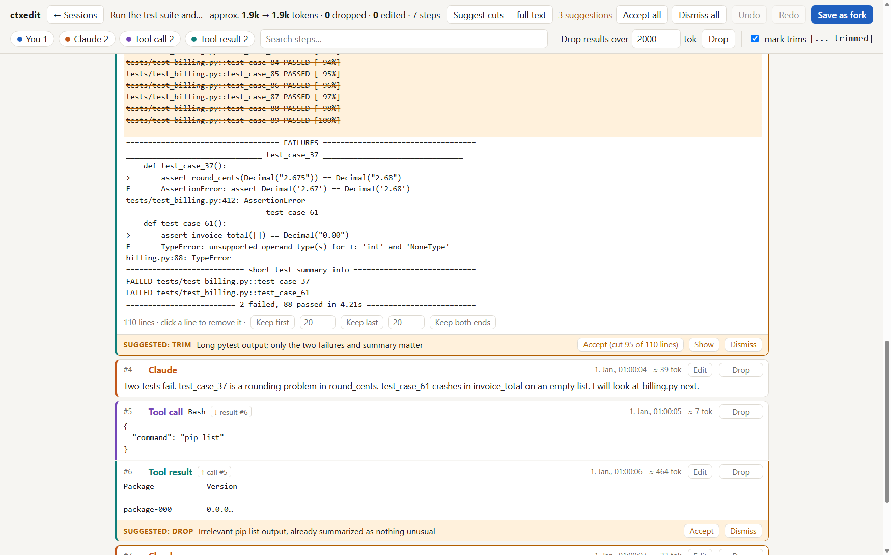

<picture>
  <source media="(prefers-color-scheme: dark)" srcset="docs/logo-dark.svg">
  
</picture>

# ctxedit

Clean up the context of a Claude Code session and continue in a fork. ctxedit
finds dead ends, bloated tool output and whole detours, and suggests what to
cut. You review and accept, or edit any step yourself. Everything you keep
stays word for word.



*"Find detours" on a demo session: the model spots a yak-shaving stretch
between a `git stash` and its pop, and proposes a short note to leave in its
place.*



*"Suggest cuts (full text)": the model proposes keeping only the failures of a
110-line test log. Nothing changes until you accept.*

## Motivation

This tool started with a video,
[NVIDIA Solves Context Rot, Invents New State Space Model](https://www.youtube.com/watch?v=4yaNxPU9pxI),
about the paper [You don't need long context](https://arxiv.org/abs/2611.05306)
(Belcak et al., NVIDIA, November 2026). The paper finds that, with frequent
compaction, models "sacrifice little to no task accuracy" in a short context.

The idea is that you don't need a 1M-token window, you need better compaction.
Context rot is a dilution problem, not a size problem. In the paper the model
writes its own compaction; ctxedit lets you do it by hand, or review what an
LLM suggests, removing what dilutes and keeping the rest word for word.

## Usage

```
./ctxedit                 # session picker (preselects the project of the current folder)
./ctxedit <session-id>    # open one session
./ctxedit <path.jsonl>    # open one file
```

It starts a server on `127.0.0.1` (random port, random token in the URL) and
opens the editor in the browser.

Options: `--no-browser`, `--port N`, `--idle-exit MINUTES` (stop by itself when
no page has been open for that long), `--detach` (start in the background,
print the URL and return), `--suggest-model NAME` (default `sonnet`,
or set `CTXEDIT_SUGGEST_MODEL`).

## Install

Needs Python 3 (standard library only, no build step) and, for "Suggest cuts",
the `claude` command. Developed and tested on Linux (WSL) with Python 3.10 and
Claude Code 2.1.330; not tried on macOS or native Windows.

```
git clone https://github.com/gregorriegler/claude-context-editor && cd claude-context-editor
ln -s "$PWD/ctxedit" ~/.local/bin/ctxedit    # optional: `ctxedit` on your PATH
./install-slash-command.sh                    # optional: /ctxedit inside Claude Code
```

### The `/ctxedit` slash command

After `./install-slash-command.sh`, typing `/ctxedit` in a Claude Code session
starts the editor in the background on that session and opens it in the
browser. The editor shows a snapshot taken at that moment. After "Save as
fork", `/exit` and run the `claude --resume <new-id>` command it shows. The
background editor stops 10 minutes after its tab is closed.

The command is installed as `~/.claude/skills/ctxedit/SKILL.md` with
`disable-model-invocation: true`, so Claude cannot invoke it and its
description is not in the model's context; you have to type it. It contains
the absolute path of this folder, so run the install script again if you move it.

## What it does

- Lists every step of the live context in order: You, Claude, Tool call, Tool
  result, Thinking, Summary, Other.
- Drop a step with one click (Shift-click for a range). A tool call and its
  result always go together. Thinking blocks are signed, so they are kept or
  dropped whole, and dropped with their turn when nothing else of it is left.
- Expand a text step and click a sentence to strike it out. Tool results are
  split by line, with "keep first / last N lines". Removed parts of a tool
  result leave a `[... trimmed]` marker (can be switched off).
- Edit rewrites a step's text; Reset brings back the original.
- Filter by type, search, bulk-drop large tool results, undo and redo.
- "Suggest cuts" asks a model (through `claude -p`) which steps look safe to
  drop, from a preview of each step. "Suggest cuts (full text)" sends every
  step in full; the model can then name the lines of a tool result or the
  sentences of Claude's text to keep (the rest is marked as a proposed cut), or
  propose a short `[summarised]` replacement for a tool result. Suggestions are
  shown on the cards and never applied on their own; "Accept all" is one undo step.
- "Find detours" asks a model for stretches where the work left the main task
  and came back later (yak shaving): a stash and its pop, "first fix X" and
  "back to Y", the word "yak". It reads an outline of the whole session (your
  messages, previews of Claude's, tool calls as one line, no tool output). For
  each detour it proposes dropping the stretch and leaving a short note in its
  place; the files changed in the stretch are added to the note. You can move
  the start and end and edit the note before accepting.
- Save writes `<new-uuid>.jsonl` next to the original, in the layout of
  Claude Code's own fork, titled `<original title> (edited)`, and shows
  `claude --resume <new-id>`. The original file is only ever read.
  An edit record goes to `~/.ctxedit/edits/<new-id>.json`.

Saving is blocked, with the failing step highlighted, if the edit would leave
invalid JSON, a tool call without its result (or the reverse), a `parentUuid`
that points nowhere, a duplicate `uuid`, or a message with empty content.
Problems that were already in the original session are reported as warnings.

## Files

| File | |
|---|---|
| `ctxcore.py` | all editing logic: parsing, dropping, pairing, re-linking, fork building, save checks. No UI code. |
| `ctxsuggest.py` | the "Suggest cuts" request and reply handling |
| `ctxedit.py` | CLI, session discovery, local HTTP server |
| `index.html` | the page: plain JavaScript and CSS |
| `FORMAT.md` | what the session files on this machine actually look like, and what was tested by resuming |
| `slash-command/`, `install-slash-command.sh` | the `/ctxedit` command for Claude Code and its installer |
| `tests/` | `python3 -m unittest discover -s tests` |

## Limits

- The session is read once when opened. Do not edit a session that is still running.
- Token counts are characters ÷ 4 (images: a flat 1,500), so they are rough.
- Harness context (attachments such as the skill listing) is shown but cannot be edited.
- Subagent transcripts and stored tool outputs stay in the original session's
  folder, as with the built-in fork. Do not delete the original session if the
  fork still refers to them.
- The session format is undocumented. `FORMAT.md` was written against Claude Code
  2.1.288 to 2.1.330; re-check after a major update.

## License

MIT, see `LICENSE`.
